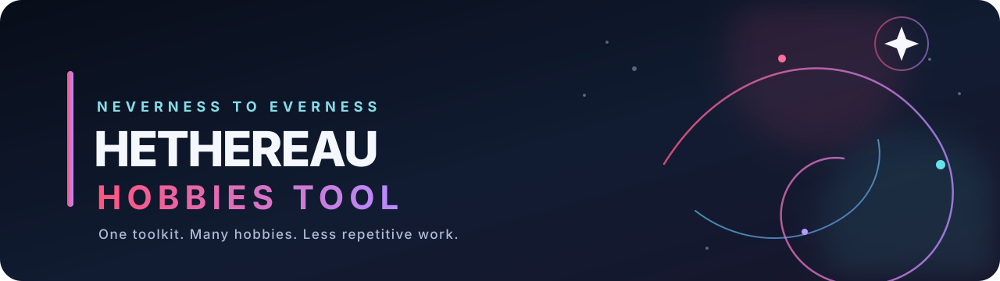

<p align="center">
  
</p>

<p align="center">
  <a href="https://github.com/M1ST0R/hethereau-hobbies-tool/actions/workflows/build.yml"></a>
  <a href="https://github.com/M1ST0R/hethereau-hobbies-tool/releases"></a>
  <a href="LICENSE"></a>
  <a href="LICENSE-MATERIAL-SYMBOLS.txt"></a>
</p>

<h3 align="center">One toolkit. Many hobbies. Less repetitive work.</h3>

<p align="center">
  <strong>Hethereau Hobbies Tool (HHT)</strong> is a growing desktop toolkit for automating hobbies and side activities in <strong>Neverness to Everness (NTE)</strong>.
  <br>
  Start with Owner's Selection today. Add fishing and more activities as separate modules tomorrow.
</p>

<p align="center">
  <a href="https://github.com/M1ST0R/hethereau-hobbies-tool/releases"><strong>Download</strong></a>
  ·
  <a href="#features"><strong>Features</strong></a>
  ·
  <a href="#quick-start"><strong>Quick start</strong></a>
  ·
  <a href="README.ru.md"><strong>Русская версия</strong></a>
</p>

---

> [!NOTE]
> HHT is an unofficial community project. It is not affiliated with, endorsed by, or supported by the developers of Neverness to Everness.

## ✦ At a glance

| | |
|---|---|
| **Current module** | Owner's Selection |
| **Game process** | `HTGame.exe` |
| **Platforms** | Windows 10/11 x64 · Linux x86_64 (X11) |
| **Interface** | English · Русский |
| **Themes** | Light · Dark |
| **Automation** | OCR + window-bound input |
| **Hotkeys** | `F6` Start / Pause · `F7` Stop |

## Features

- **Game-aware automation** — attaches to the `HTGame.exe` window and calculates clicks relative to its client area.
- **Owner's Selection module** — opens the event shop, taps the hammer, tracks income, claims the challenge reward, checks energy, and repeats while possible.
- **Adaptive income target** — reads the target shown by the current level; no hard-coded 1100 / 1900 level table.
- **OCR validation** — separates the changing yellow income from the static white target and confirms readings before acting.
- **Live dashboard** — cycle count, energy, income, game connection, status, and hotkey hints.
- **Separate utility windows** — open the full activity log or the About dialog when needed.
- **Personalized interface** — language dropdown, Light / Dark switch, and saved preferences.
- **Material Symbols Outlined** — official SVG glyphs bundled locally and tinted for the active theme. No remote font requests.
- **Windows elevation** — the Windows build requests Administrator privileges through UAC so HHT can send input to an elevated game process.

## Downloads

Get the latest published version from **[GitHub Releases](https://github.com/M1ST0R/hethereau-hobbies-tool/releases)**.

| Platform | Package | Notes |
|---|---|---|
| **Windows 10/11 x64** | `Hethereau-HHT-Windows-x64.exe` | Portable single-file app; Tesseract OCR is bundled |
| **Debian / Ubuntu x86_64** | `hethereau-hobbies-tool_VERSION_amd64.deb` | Installable package for X11 |
| **Linux x86_64** | `Hethereau-HHT-Linux-x86_64.tar.gz` | Portable PyInstaller folder; install Tesseract separately |

No release yet? The latest CI packages can be downloaded from **[Actions → Build HHT packages](https://github.com/M1ST0R/hethereau-hobbies-tool/actions/workflows/build.yml)**. Open a successful run and download the `HHT-windows-x64` or `HHT-linux-x86_64` artifact.

## Quick start

### Windows

1. Download `Hethereau-HHT-Windows-x64.exe` from [Releases](https://github.com/M1ST0R/hethereau-hobbies-tool/releases).
2. Launch HHT and approve the Windows UAC prompt.
3. Open **Owner's Selection** in NTE.
4. Wait until HHT finds `HTGame.exe`.
5. Press **Start / Pause** or `F6`.

The packaged EXE contains a `requireAdministrator` manifest. To run from source, use `start.bat`; it requests elevation before installing Python dependencies.

### Linux (Debian / Ubuntu, X11)

Install the package:

```bash
sudo apt install ./hethereau-hobbies-tool_*_amd64.deb
```

Then launch **Hethereau Hobbies Tool** from the application menu or run:

```bash
hht
```

HHT runs as the current desktop user. **Do not launch it with `sudo`** — elevated root GUI processes can lose access to the user's desktop session and input devices.

### Run from source

Requirements: Python 3.10+, Tk support, Tesseract OCR. Linux additionally requires X11, `scrot`, `wmctrl`, and Cairo development libraries.

**Windows:** run `start.bat`.

**Linux:**

```bash
chmod +x start.sh
./start.sh
```

## Controls

| Action | Control |
|---|---|
| Start automation | `F6` |
| Pause / resume | `F6` |
| Stop automation | `F7` |
| Emergency stop | Move the cursor to the top-left screen corner |
| Change language | Language dropdown in the header |
| Change appearance | Light / Dark switch in the header |
| View activity history | **View logs** |
| App information | **About** |

## How level detection works

The challenge target can differ between levels. HHT reads the current / target counter from the game instead of relying on a fixed list.

To reduce mistakes such as reading `1270/1900` as `70/1`, the Owner's Selection module:
1. Separates the yellow current-income digits from the white target digits.
2. Confirms the static target with independent OCR passes.
3. Reuses the confirmed target during the active challenge.
4. Prefers valid readings that preserve leading digits and never accepts a current value greater than the target.
5. Requires the target to be reached in consecutive reads before leaving the event.

The first run on a new resolution or level should be supervised.

## Diagnostics

Use **Test OCR** in the app. HHT saves the captured counter regions beside the application:

- `debug_income_capture.png` — income counter;
- `debug_energy_capture.png` — energy counter.

When reporting an OCR issue, attach both images and copy the recent activity log.

## Project direction

HHT is intended to become a collection of small, independent activity modules rather than one script tied to a single event.

| Module | Status |
|---|---|
| Owner's Selection | <strong>Available</strong> |
| Fishing | Planned |
| More NTE hobbies | Planned |

Each module can have its own window logic, screen regions, OCR strategy, controls, and status reporting while sharing the same app shell.

## Building

GitHub Actions builds both platforms on pushes to `main`, pull requests, and manual dispatches.

- [Build workflow](.github/workflows/build.yml)
- Windows: one-file EXE with UAC manifest.
- Linux: Debian package and portable TAR.GZ.
- Push a version tag such as `v0.4.0` to create a GitHub Release automatically.

## App icon

The launcher icon is intentionally kept separate from the interface symbols. The application loads `assets/app_icon.png` when present; the build workflow generates a multi-size Windows `.ico` and includes the PNG in the Linux package.

**Icon artwork location:** `assets/app_icon.png` (square PNG, recommended 1024×1024 with transparent background).

## Credits

- UI glyphs: [Google Material Symbols Outlined](https://github.com/google/material-design-icons), licensed under Apache License 2.0. See [LICENSE-MATERIAL-SYMBOLS.txt](LICENSE-MATERIAL-SYMBOLS.txt).
- HHT source code: MIT. See [LICENSE](LICENSE).

---

<p align="center">
  <sub>Built for the little things you would rather not repeat.</sub>
</p>
