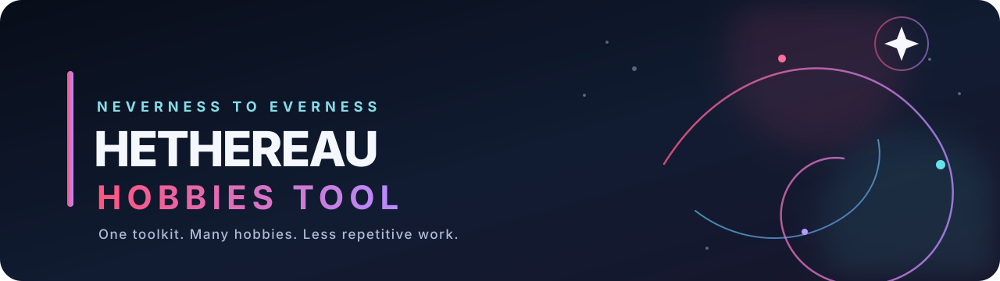

<p align="center">
  
</p>

<p align="center">
  
</p>

<p align="center">
  <a href="https://github.com/M1ST0R/hethereau-hobbies-tool/actions/workflows/build.yml"></a>
  <a href="https://github.com/M1ST0R/hethereau-hobbies-tool/releases"></a>
  <a href="LICENSE"></a>
  <a href="LICENSE-MATERIAL-SYMBOLS.txt"></a>
</p>

<h3 align="center">Один инструмент. Много хобби. Меньше рутины.</h3>

<p align="center">
  <strong>Hethereau Hobbies Tool (HHT)</strong> — развивающийся desktop-инструмент для автоматизации хобби и дополнительных активностей в <strong>Neverness to Everness (NTE)</strong>.
  <br>
  Сегодня — «Подборка владельца». Завтра — рыбалка и другие игровые занятия в виде отдельных модулей.
</p>

<p align="center">
  <a href="https://github.com/M1ST0R/hethereau-hobbies-tool/releases"><strong>Скачать</strong></a>
  ·
  <a href="#возможности"><strong>Возможности</strong></a>
  ·
  <a href="#быстрый-старт"><strong>Быстрый старт</strong></a>
  ·
  <a href="README.md"><strong>English version</strong></a>
</p>

---

> [!NOTE]
> HHT — неофициальный пользовательский проект. Он не связан с разработчиками Neverness to Everness и не поддерживается ими.

## ✦ Кратко о проекте

| | |
|---|---|
| **Текущий модуль** | Подборка владельца |
| **Процесс игры** | `HTGame.exe` |
| **Платформы** | Windows 10/11 x64 · Linux x86_64 (X11) |
| **Интерфейс** | English · Русский |
| **Темы** | Светлая · Тёмная |
| **Автоматизация** | OCR + привязка к окну игры |
| **Хоткеи** | `F6` запуск / пауза · `F7` остановка |

## Возможности

- **Работа с окном игры** — подключение к `HTGame.exe`, расчёт координат кликов относительно клиентской области.
- **Модуль «Подборка владельца»** — открывает магазин события, нажимает молоток, отслеживает доход, получает награду, проверяет энергию и повторяет цикл.
- **Адаптация к уровню** — целевой доход определяется по счётчику игры; таблица фиксированных лимитов вроде 1100 / 1900 не нужна.
- **Проверка OCR** — отделение жёлтого текущего дохода от белого целевого значения, подтверждение распознавания перед действием.
- **Панель состояния** — циклы, энергия, доход, подключение к игре, статус и горячие клавиши.
- **Отдельные окна** — полный журнал действий и окно «О программе».
- **Настройка интерфейса** — выпадающий список языков, переключатель светлой / тёмной темы, сохранение настроек.
- **Material Symbols Outlined** — оригинальные SVG-иконки Google встроены локально и подстраиваются под тему. Удалённые шрифты не загружаются.
- **Права Windows** — сборка запрашивает повышение через UAC, чтобы HHT мог отправлять ввод в игру с повышенными правами.

## Скачать

Последнюю опубликованную версию ищи в разделе **[GitHub Releases](https://github.com/M1ST0R/hethereau-hobbies-tool/releases)**.

| Платформа | Пакет | Примечания |
|---|---|---|
| **Windows 10/11 x64** | `Hethereau-HHT-Windows-x64.exe` | Один переносимый EXE; Tesseract OCR включён |
| **Debian / Ubuntu x86_64** | `hethereau-hobbies-tool_VERSION_amd64.deb` | Установочный пакет для X11 |
| **Linux x86_64** | `Hethereau-HHT-Linux-x86_64.tar.gz` | Переносимая сборка; Tesseract устанавливается отдельно |

Пока релиза нет? Готовые CI-сборки доступны в **[Actions → Build HHT packages](https://github.com/M1ST0R/hethereau-hobbies-tool/actions/workflows/build.yml)**. Открой успешный запуск и скачай артефакт `HHT-windows-x64` или `HHT-linux-x86_64`.

## Быстрый старт

### Windows

1. Скачай `Hethereau-HHT-Windows-x64.exe` из [Releases](https://github.com/M1ST0R/hethereau-hobbies-tool/releases).
2. Запусти HHT и подтверди запрос Windows UAC.
3. Открой в NTE событие **«Подборка владельца»**.
4. Дождись, пока HHT найдёт `HTGame.exe`.
5. Нажми **Запуск / Пауза** или `F6`.

EXE содержит манифест `requireAdministrator`. Для запуска из исходников используй `start.bat`: он запросит повышение прав перед установкой Python-зависимостей.

### Linux (Debian / Ubuntu, X11)

Установи пакет:

```bash
sudo apt install ./hethereau-hobbies-tool_*_amd64.deb
```

Затем запусти **Hethereau Hobbies Tool** из меню приложений или выполни:

```bash
hht
```

HHT работает от имени текущего пользователя графической сессии. **Не запускай его через `sudo`** — root-процесс может потерять доступ к пользовательской графической сессии и устройствам ввода.

### Запуск из исходников

Требования: Python 3.10+, поддержка Tk, Tesseract OCR. Для Linux дополнительно нужны X11, `scrot`, `wmctrl` и библиотеки Cairo для сборки.

**Windows:** запусти `start.bat`.

**Linux:**

```bash
chmod +x start.sh
./start.sh
```

## Управление

| Действие | Управление |
|---|---|
| Запуск автоматизации | `F6` |
| Пауза / продолжение | `F6` |
| Остановка | `F7` |
| Аварийная остановка | Перемести курсор в левый верхний угол экрана |
| Смена языка | Выпадающий список в шапке |
| Смена темы | Переключатель Светлая / Тёмная |
| Журнал действий | **Посмотреть логи** |
| Информация о программе | **О программе** |

## Как определяется целевой доход

Лимит может отличаться в зависимости от уровня. HHT считывает целевой показатель непосредственно из игрового счётчика, а не использует фиксированную таблицу.

Чтобы не путать `1270/1900` с `70/1`, модуль «Подборка владельца»:
1. Отделяет жёлтые цифры текущего дохода от белых цифр цели.
2. Подтверждает постоянный целевой лимит несколькими независимыми OCR-проходами.
3. Повторно использует подтверждённую цель в течение текущего испытания.
4. Предпочитает корректные значения с сохранёнными ведущими цифрами и не принимает текущий доход выше цели.
5. Требует повторного подтверждения достижения цели, прежде чем закрыть событие.

Первый запуск на новом разрешении или уровне рекомендуется контролировать.

## Диагностика

Используй кнопку **Проверить распознавание**. HHT сохраняет снимки областей счётчиков рядом с приложением:

- `debug_income_capture.png` — счётчик дохода;
- `debug_energy_capture.png` — счётчик энергии.

При сообщении об ошибке OCR приложи оба изображения и скопируй последние записи журнала.

## Направление проекта

HHT должен стать набором небольших независимых модулей для разных занятий, а не одним скриптом для одного события.

| Модуль | Статус |
|---|---|
| Подборка владельца | <strong>Доступен</strong> |
| Рыбалка | В планах |
| Другие хобби NTE | В планах |

У каждого модуля может быть собственная логика окна, области экрана, OCR, управление и статусы. Общими останутся оболочка приложения и настройки.

## Сборка

GitHub Actions собирает обе платформы при push в `main`, создании Pull Request и ручном запуске.

- [Workflow сборки](.github/workflows/build.yml)
- Windows: единый EXE с UAC-манифестом.
- Linux: пакет DEB и переносимый TAR.GZ.
- Для автоматической публикации GitHub Release отправь версионный тег, например `v0.4.0`.

## Иконка приложения

Иконка запуска отделена от интерфейсных символов. Если файл `assets/app_icon.png` присутствует, приложение покажет его в окне, а workflow автоматически создаст многоразмерный Windows `.ico` и добавит PNG в Linux-пакет.

**Куда положить иконку:** `assets/app_icon.png` (квадратный PNG, рекомендуется 1024×1024 с прозрачным фоном).

## Благодарности

- Иконки интерфейса: [Google Material Symbols Outlined](https://github.com/google/material-design-icons), лицензия Apache 2.0. См. [LICENSE-MATERIAL-SYMBOLS.txt](LICENSE-MATERIAL-SYMBOLS.txt).
- Исходный код HHT: MIT. См. [LICENSE](LICENSE).

---

<p align="center">
  <sub>Для тех мелочей, которые не хочется повторять вручную.</sub>
</p>
